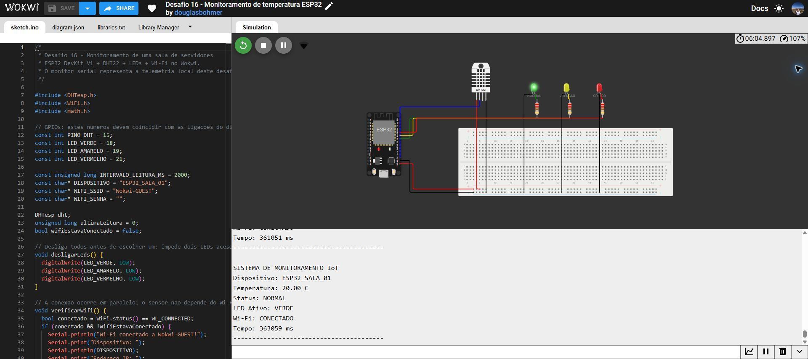
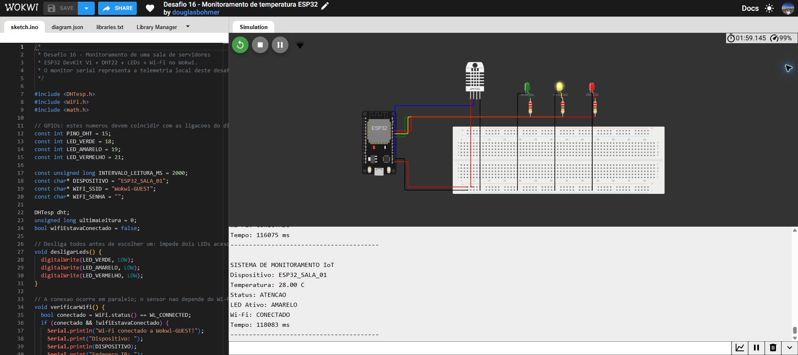

# Desafio 16 Monitoramento de temperatura com ESP32

Aluno: Douglas Bohmer | Data: 14/10/2026

Projeto no Wokwi: [https://wokwi.com/projects/477891055977330689](https://wokwi.com/projects/477891055977330689)

Repositório no GitHub: [https://github.com/DouglasBohmer/Monitoramento-Esp32-Wokwi](https://github.com/DouglasBohmer/Monitoramento-Esp32-Wokwi)

**1. Qual é a diferença entre sensor e atuador? Identifique ambos no seu projeto.**

O sensor mede uma grandeza do ambiente. Neste projeto, o DHT22 mede a temperatura. O atuador recebe um comando e produz uma ação. Os LEDs são os atuadores: eles acendem conforme a faixa de temperatura identificada pelo ESP32.

**2. O que seria necessário acrescentar para monitorar os dados remotamente pela internet?**

Seria necessário enviar as leituras do ESP32 para um servidor ou uma plataforma na internet, usando MQTT ou HTTP/HTTPS, e ter um painel para consultar os dados. A conexão Wi-Fi já está implementada, mas, neste projeto, as informações aparecem apenas no monitor serial e ainda não são enviadas para a nuvem.

20 °C - LED verde e status NORMAL

28 °C - LED amarelo e status ATENÇÃO

35 °C - LED vermelho e status CRÍTICO

